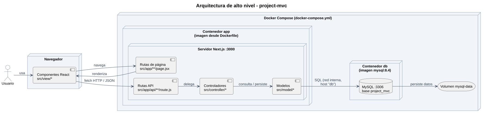

# Arquitectura de alto nivel

Aplicación web con **Next.js (App Router) + React**, organizada con el patrón **MVC**, con base de datos **MySQL**. La app y la base de datos corren en contenedores separados que se levantan juntos con **Docker Compose**.

## Vista general



## Capas

| Capa | Carpeta | Responsabilidad |
|---|---|---|
| Rutas | `src/app/` | Define las URL. Cada `page.jsx` solo monta una vista; cada `route.js` solo delega en un controlador |
| Vista (V) | `src/view/` | Componentes React: listas, formularios y componentes compartidos |
| Controlador (C) | `src/controller/` | Valida la petición, aplica reglas de negocio y llama al modelo |
| Modelo (M) | `src/model/` | Estructura de cada entidad y acceso a MySQL |
| Recursos | `src/assets/`, `public/` | CSS, imágenes, librerías propias y archivos públicos |

## Flujo de una petición

Los diagramas de secuencia de cada flujo están en [05-sequence-diagram.md](05-sequence-diagram.md).

## Rutas

| Módulo | Página | API |
|---|---|---|
| client | `/client/person`, `/client/person/[id]` | `/api/person`, `/api/person/[id]` |
| client | `/client/user`, `/client/user/[id]` | `/api/user`, `/api/user/[id]` |
| reservation | `/reservation`, `/reservation/[id]` | `/api/reservation`, `/api/reservation/[id]` |
| reservation | `/reservation/reservation-type`, `/reservation/reservation-type/[id]` | `/api/reservation-type`, `/api/reservation-type/[id]` |
| location | `/location/state`, `/location/state/[id]` | `/api/state`, `/api/state/[id]` |
| location | `/location/city`, `/location/city/[id]` | `/api/city`, `/api/city/[id]` |
| system | `/` | `/api/health` |

Cada API de entidad expone: `GET` (listar) y `POST` (crear) en la ruta base; `GET`, `PUT` y `DELETE` en `[id]`. `/api/health` solo expone `GET` y responde si la app llega a la base de datos.

## Contenedores

| Servicio | Imagen | Puerto | Descripción |
|---|---|---|---|
| `app` | Se construye desde el `Dockerfile` del proyecto | 3000 | Servidor Next.js (vistas, API, controladores y modelos) |
| `db` | `mysql:8.4` (oficial) | 3306 | Base de datos `project_mvc`. Al crearse por primera vez ejecuta los scripts de `public/docs/model-data/` |

- **Un solo comando:** `docker compose up -d --build` levanta los dos servicios.
- **Red interna:** la app se conecta a MySQL con el host `db` (el nombre del servicio), no con `localhost`.
- **Persistencia:** los datos viven en el volumen `mysql-data`. Sobreviven a `docker compose down`, pero no a `docker compose down -v`.
- **Credenciales:** van en `.env`, que no se sube al repositorio. `.env.example` sirve de plantilla.
- **Orden de arranque:** `app` espera a que `db` pase su healthcheck antes de iniciar.

Archivos de configuración en la raíz del proyecto:

```
project-mvc/
├── Dockerfile            ← imagen de la app Next.js
├── docker-compose.yml    ← servicios app + db, red y volumen
├── .dockerignore
├── .env.example          ← plantilla de variables (DB_HOST, DB_USER…)
├── package.json
├── next.config.mjs
└── jsconfig.json
```

El script de la base de datos está en [`../model-data/01-schema.sql`](../model-data/01-schema.sql). El servicio `db` lo monta como `./public/docs/model-data:/docker-entrypoint-initdb.d:ro`.

## Decisiones tomadas

- **Lenguaje:** JavaScript (no TypeScript). Los archivos usan `.js` y `.jsx`.
- **Person → User:** una persona tiene como máximo un usuario (`UNIQUE` en `user.person_id`).

## Decisiones pendientes

- **Roles:** columna `role` en `user` (o tabla `role`). Se decide al construir el inicio de sesión.
