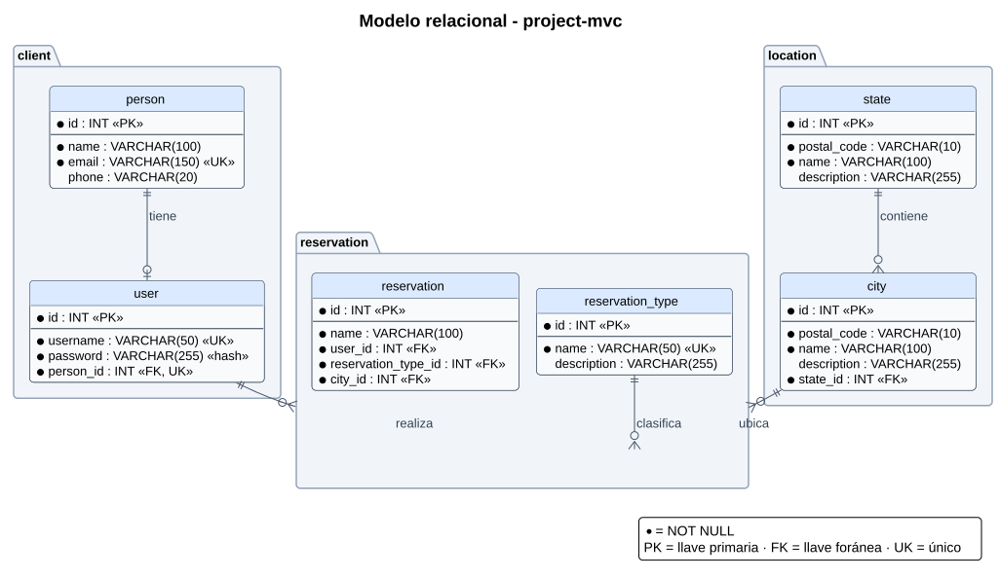

# Modelo relacional (MR)

Nombres según [best-practice.md](../governance/best-practice.md#34-base-de-datos-mysql): tablas y columnas en `snake_case`, minúsculas y singular. El script está en [`../model-data/01-schema.sql`](../model-data/01-schema.sql).

## Diagrama

## Tablas

### Módulo client

| Tabla | Columna | Tipo | Restricción |
|---|---|---|---|
| person | id | INT | PK, autoincremental |
| person | name | VARCHAR(100) | NOT NULL |
| person | email | VARCHAR(150) | NOT NULL, UNIQUE |
| person | phone | VARCHAR(20) | |
| user | id | INT | PK, autoincremental |
| user | username | VARCHAR(50) | NOT NULL, UNIQUE |
| user | password | VARCHAR(255) | NOT NULL (se guarda el hash) |
| user | person_id | INT | NOT NULL, UNIQUE, FK → person.id |

### Módulo reservation

| Tabla | Columna | Tipo | Restricción |
|---|---|---|---|
| reservation_type | id | INT | PK, autoincremental |
| reservation_type | name | VARCHAR(50) | NOT NULL, UNIQUE |
| reservation_type | description | VARCHAR(255) | |
| reservation | id | INT | PK, autoincremental |
| reservation | name | VARCHAR(100) | NOT NULL |
| reservation | user_id | INT | NOT NULL, FK → user.id |
| reservation | reservation_type_id | INT | NOT NULL, FK → reservation_type.id |
| reservation | city_id | INT | NOT NULL, FK → city.id |

### Módulo location

| Tabla | Columna | Tipo | Restricción |
|---|---|---|---|
| state | id | INT | PK, autoincremental |
| state | postal_code | VARCHAR(10) | NOT NULL |
| state | name | VARCHAR(100) | NOT NULL |
| state | description | VARCHAR(255) | |
| city | id | INT | PK, autoincremental |
| city | postal_code | VARCHAR(10) | NOT NULL |
| city | name | VARCHAR(100) | NOT NULL |
| city | description | VARCHAR(255) | |
| city | state_id | INT | NOT NULL, FK → state.id |

## Relaciones

| Relación | Cardinalidad | Regla al borrar |
|---|---|---|
| person → user | 1 : 0..1 | No se borra una person que tenga user |
| user → reservation | 1 : N | No se borra un user que tenga reservation |
| reservation_type → reservation | 1 : N | No se borra un tipo en uso |
| state → city | 1 : N | No se borra un state que tenga city |
| city → reservation | 1 : N | No se borra una city que tenga reservation |

## Observaciones

- **`user.username`:** en el modelo original la columna se llamaba `User`, igual que la tabla. Se renombró a `username` para no repetir el nombre de la tabla en la columna (`user.user`).
- **Person → User es 1 : 0..1.** Cada persona tiene como máximo un usuario: `user.person_id` es `UNIQUE` (restricción `uk_user_person_id`).
- **`reservation.city_id` conecta el módulo reservation con location:** cada reserva se hace en una ciudad.
- **Motor: MySQL 8.4.** Las tablas usan InnoDB y utf8mb4 para que las llaves foráneas funcionen y se acepten tildes y ñ.
- **Minúsculas obligatorias:** MySQL en Linux (Docker) distingue mayúsculas en los nombres de tabla.
