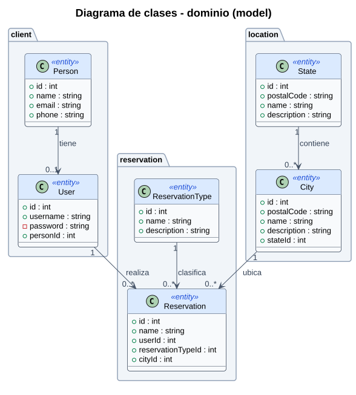
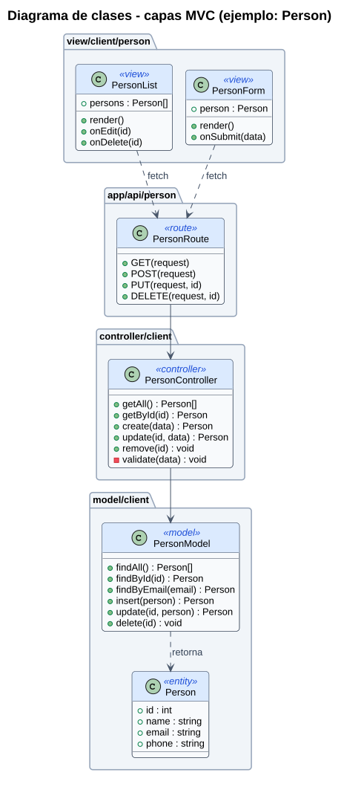
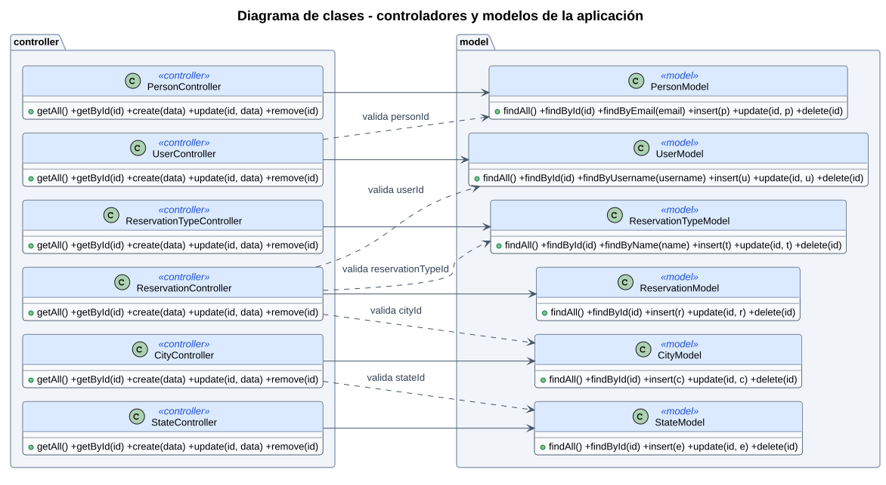

# Diagrama de clases

## 1. Clases del dominio (model)

`password` es privado: el modelo nunca lo devuelve en una consulta.

## 2. Capas MVC por entidad

Todas las entidades siguen el mismo patrón. Ejemplo con **Person**:

## 3. Controladores y modelos de la aplicación

## Archivos que corresponden a cada clase

Las clases y componentes van en PascalCase; los archivos, en kebab-case ([best-practice.md](../governance/best-practice.md#2-cuándo-usar-cada-notación)).

| Clase / componente | Archivo |
|---|---|
| PersonList, PersonForm | `src/view/client/person/person-list.jsx`, `person-form.jsx` |
| UserList, UserForm | `src/view/client/user/user-list.jsx`, `user-form.jsx` |
| ReservationTypeList, ReservationTypeForm | `src/view/reservation/reservation-type/reservation-type-list.jsx`, `reservation-type-form.jsx` |
| ReservationList, ReservationForm | `src/view/reservation/reservation/reservation-list.jsx`, `reservation-form.jsx` |
| StateList, StateForm | `src/view/location/state/state-list.jsx`, `state-form.jsx` |
| CityList, CityForm | `src/view/location/city/city-list.jsx`, `city-form.jsx` |
| PersonController | `src/controller/client/person-controller.js` |
| UserController | `src/controller/client/user-controller.js` |
| ReservationTypeController | `src/controller/reservation/reservation-type-controller.js` |
| ReservationController | `src/controller/reservation/reservation-controller.js` |
| StateController | `src/controller/location/state-controller.js` |
| CityController | `src/controller/location/city-controller.js` |
| PersonModel | `src/model/client/person-model.js` |
| UserModel | `src/model/client/user-model.js` |
| ReservationTypeModel | `src/model/reservation/reservation-type-model.js` |
| ReservationModel | `src/model/reservation/reservation-model.js` |
| StateModel | `src/model/location/state-model.js` |
| CityModel | `src/model/location/city-model.js` |
