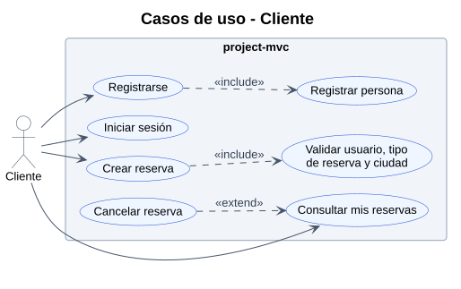
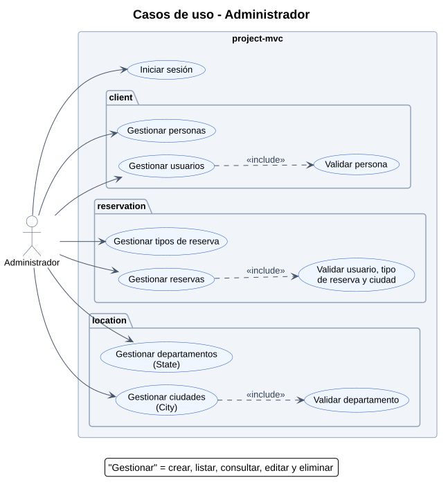

# Casos de uso

## Actores

| Actor | Descripción |
|---|---|
| Cliente | Persona que se registra y gestiona sus propias reservas |
| Administrador | Gestiona los catálogos (tipos de reserva, departamentos, ciudades), las personas, los usuarios y todas las reservas |

## Cliente

## Administrador

## Descripción de los casos de uso

| Caso de uso | Actor | Descripción | Relación |
|---|---|---|---|
| Registrarse | Cliente | Crea su Person y su User | «include» Registrar persona |
| Iniciar sesión | Ambos | Ingresa con username y password | |
| Crear reserva | Cliente | Crea una Reservation a su nombre eligiendo un ReservationType y una City | «include» Validar usuario, tipo y ciudad |
| Consultar mis reservas | Cliente | Lista solo sus Reservation | |
| Cancelar reserva | Cliente | Elimina una de sus reservas desde la consulta | «extend» Consultar mis reservas |
| Gestionar personas | Administrador | CRUD de Person | |
| Gestionar usuarios | Administrador | CRUD de User | «include» Validar persona |
| Gestionar tipos de reserva | Administrador | CRUD de ReservationType | |
| Gestionar reservas | Administrador | CRUD de todas las Reservation | «include» Validar usuario, tipo y ciudad |
| Gestionar departamentos | Administrador | CRUD de State | |
| Gestionar ciudades | Administrador | CRUD de City | «include» Validar departamento |

## Supuestos por validar

- **Roles:** las tablas no tienen un campo de rol. Para distinguir Cliente de Administrador falta una columna `role` en `user`, o una tabla `role`.
- **Iniciar sesión:** el inicio de sesión no está construido; se propone porque user tiene password.
