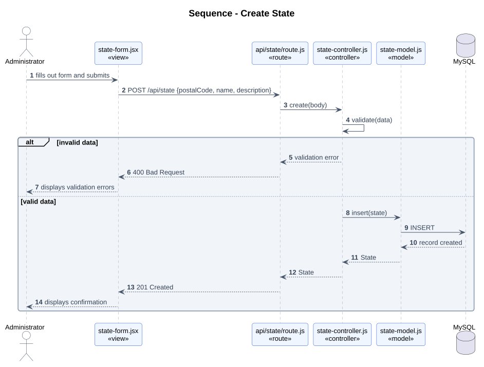
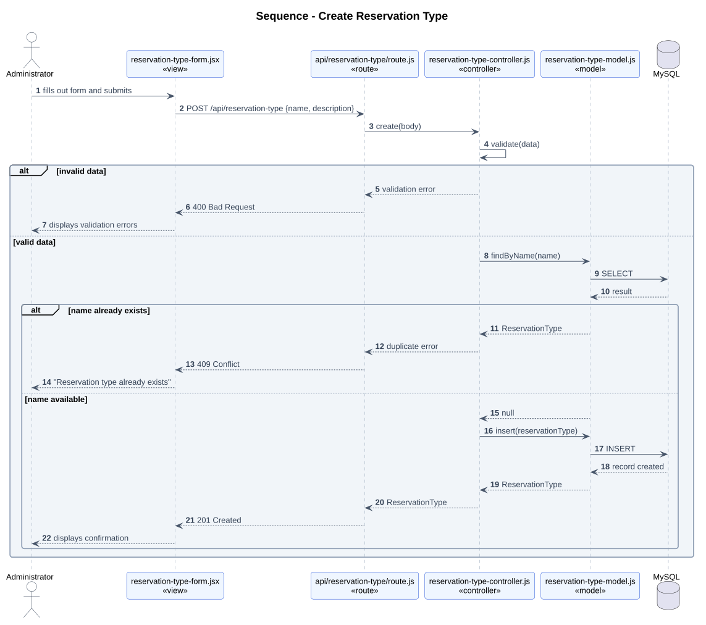
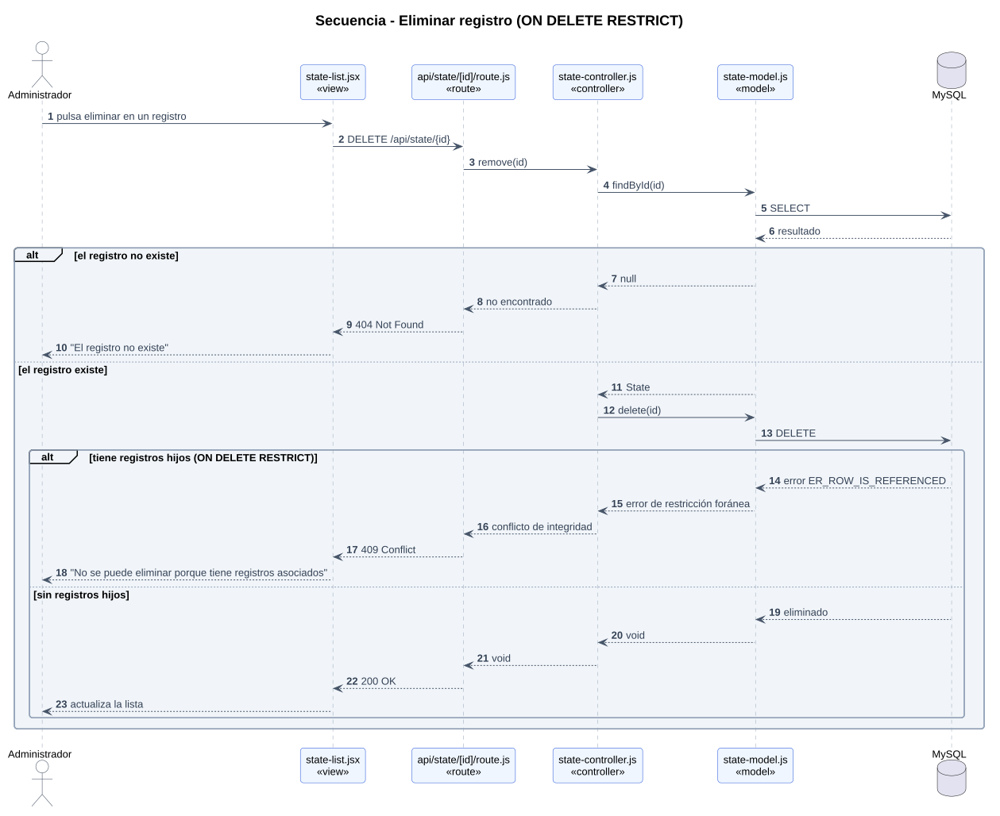

# Diagramas de secuencia

Todos los flujos recorren las mismas capas: **view → route (API) → controller → model → MySQL**.

## Registrar persona

Valida los datos y que el email no esté repetido.

## Crear usuario

Valida que la Person exista y guarda la contraseña con hash.

## Crear reserva

Valida que existan el User, el ReservationType y la City.

## Crear ciudad

Valida que exista el State.

## Create State

Validates required fields (`postalCode` and `name`) and inserts the record.

## Create Reservation Type

Validates required fields and checks that the reservation type `name` is not duplicated.

## Delete Record (Foreign Key Constraint)

Verifies that the record exists and handles the `ON DELETE RESTRICT` constraint when child records are associated.

## Códigos de respuesta usados

| Código | Cuándo |
|---|---|
| 200 OK | Successful query, update, or deletion completed |
| 201 Created | Registro creado |
| 400 Bad Request | Datos inválidos o incompletos |
| 404 Not Found | La llave foránea apunta a un registro que no existe |
| 409 Conflict | Duplicate unique value (`email`, `username`, `name`) or parent record with associated child records (`ON DELETE RESTRICT`) |
