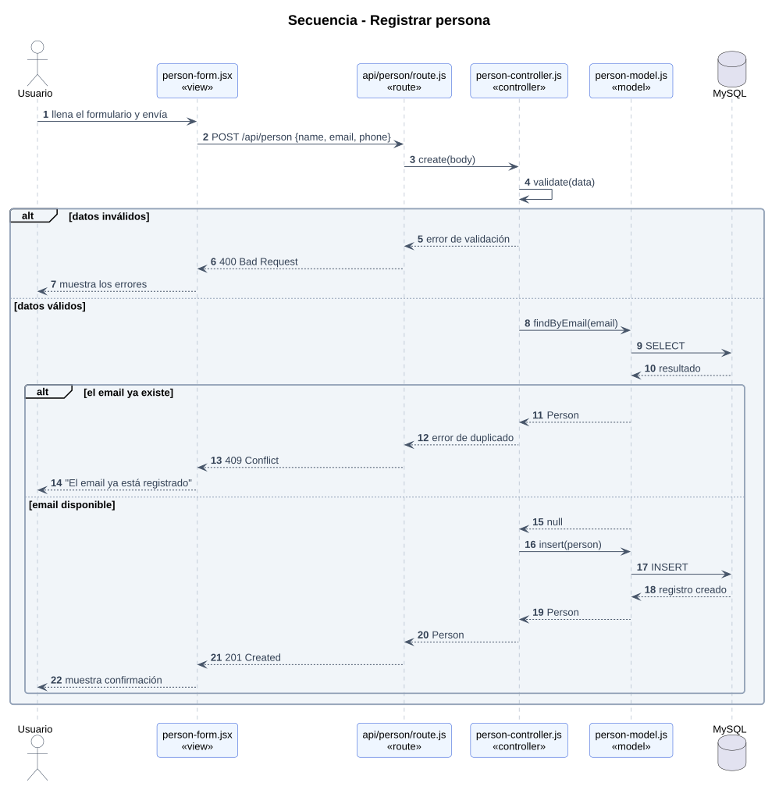
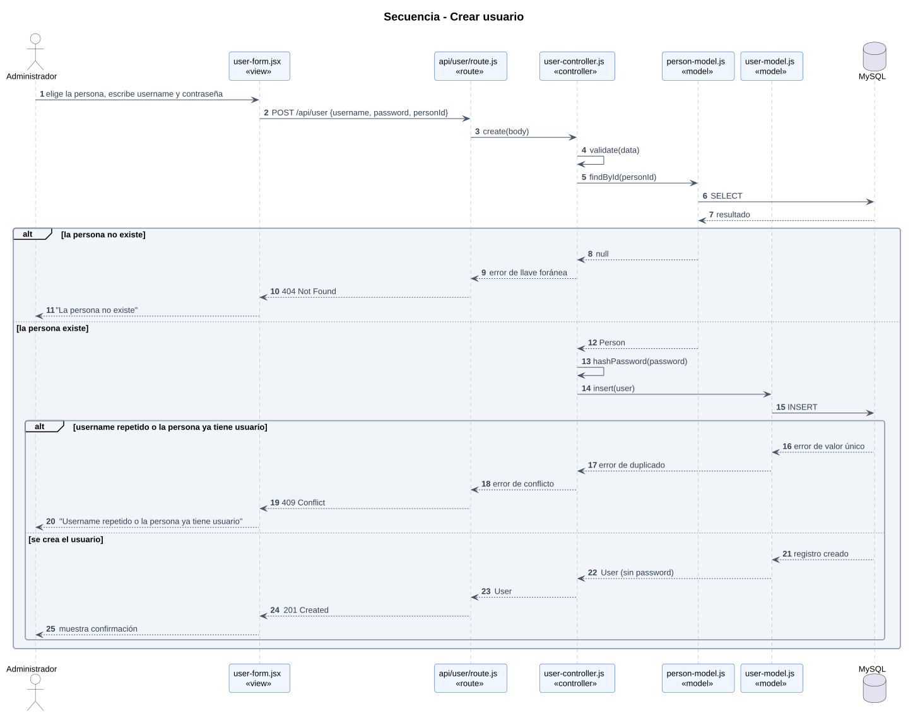
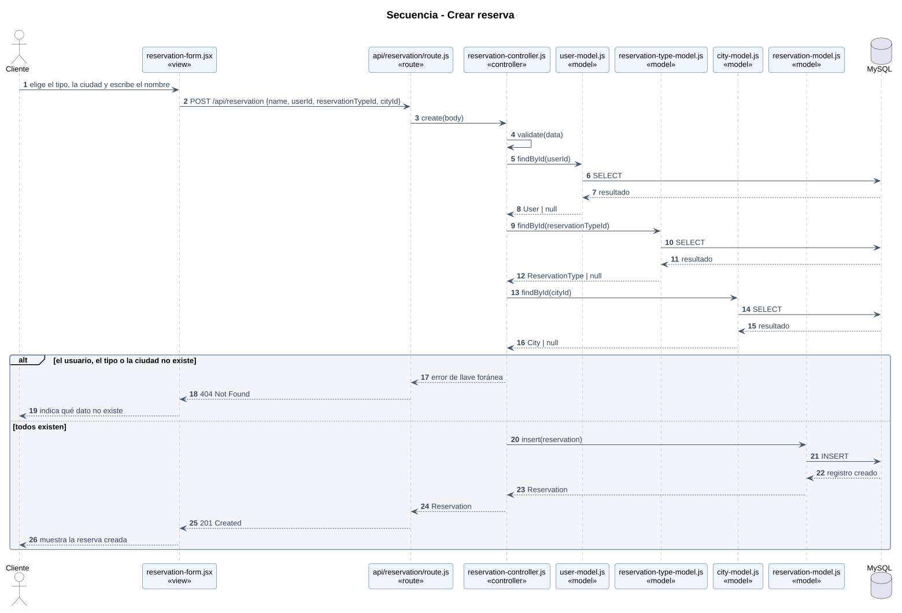
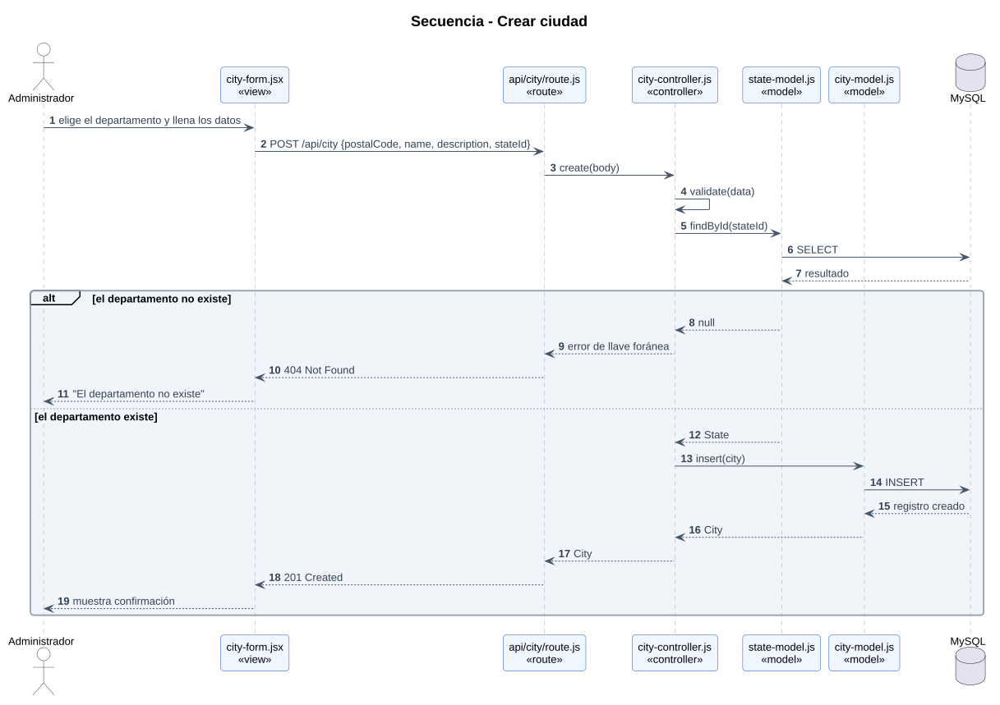

# Diagramas de secuencia

Todos los flujos recorren las mismas capas: **view → route (API) → controller → model → MySQL**.

## Registrar persona

Valida los datos y que el email no esté repetido.

## Crear usuario

Valida que la Person exista, que no tenga ya un usuario y que el username no esté repetido, y guarda la contraseña con hash.

## Crear reserva

Valida que existan el User, el ReservationType y la City.

## Crear ciudad

Valida que exista el State.

## Códigos de respuesta usados

| Código | Cuándo |
|---|---|
| 201 Created | Registro creado |
| 400 Bad Request | Datos inválidos o incompletos |
| 404 Not Found | La llave foránea apunta a un registro que no existe |
| 409 Conflict | Valor único repetido (por ejemplo, el email, el username o una person que ya tiene user) |
